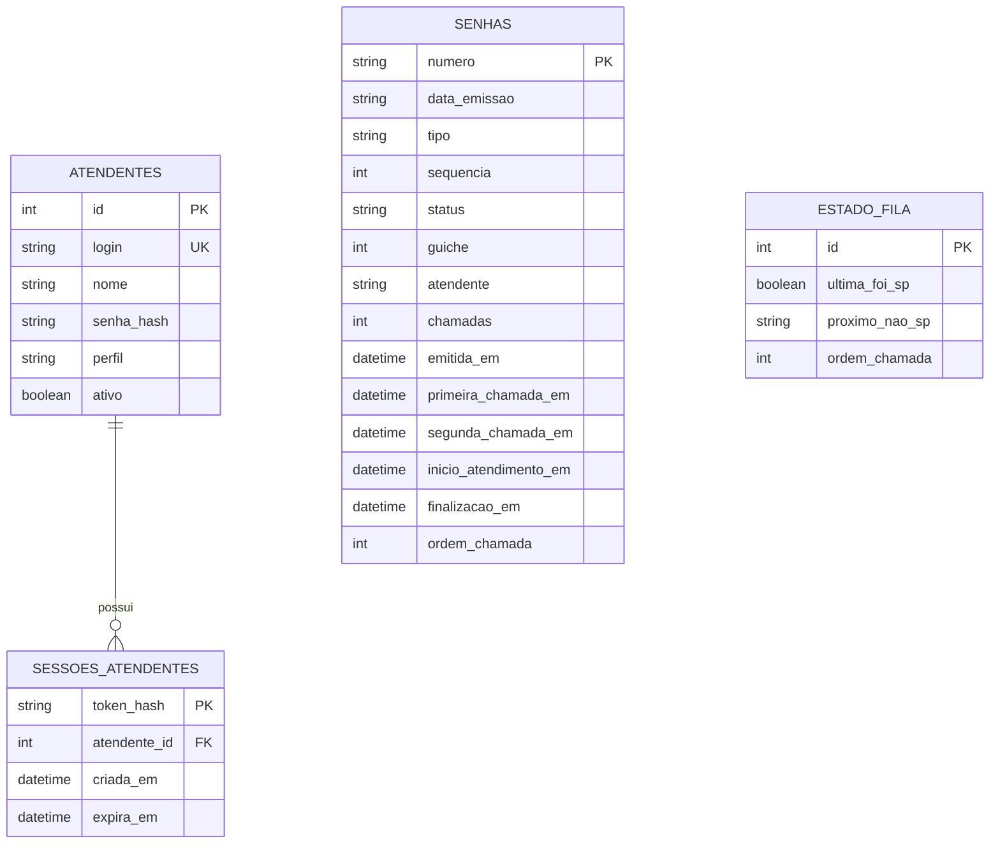

# Modelo de dados

Os scripts oficiais para criar as tabelas são `001_senhas_fila.sql` e `002_autenticacao.sql`, nesta pasta. Execute os dois no banco informado por `DB_NAME`.

`SENHAS.atendente` registra o nome do atendente no momento da chamada. Não há chave estrangeira entre essa coluna e `ATENDENTES`; a sessão identifica o usuário que executa a chamada.
