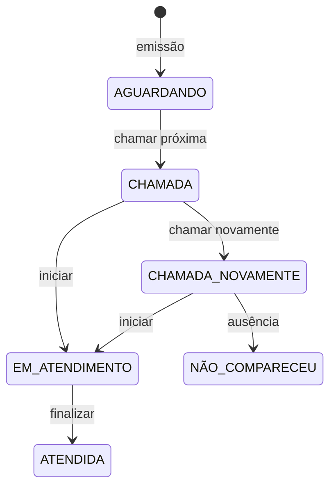

# Fluxo e estados da senha

O esquema também admite o estado `EMITIDA`, mas a emissão atual grava diretamente `AGUARDANDO`. O painel consulta chamadas concluídas ou ativas pela ordem de chamada e não calcula a próxima senha.
