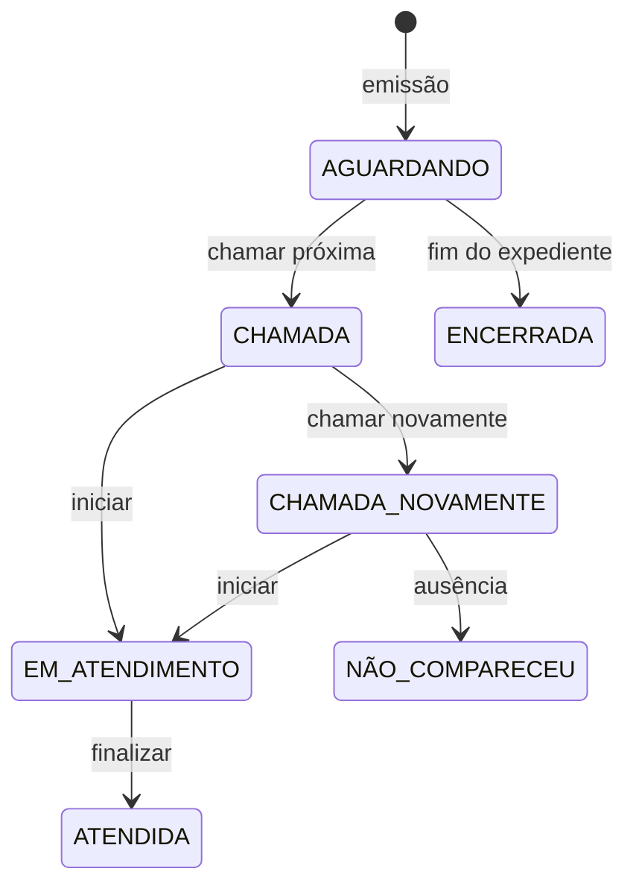
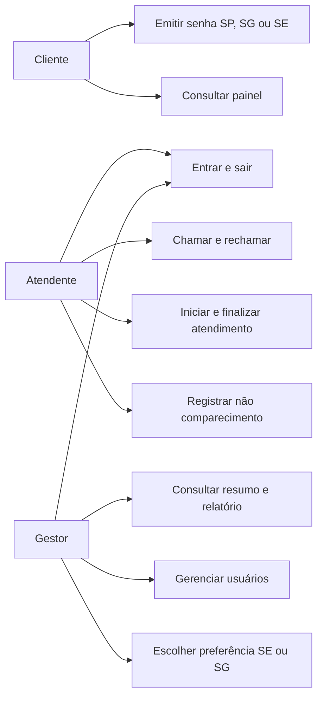

# Fluxo e estados da senha

O esquema também admite o estado `EMITIDA`, mas a emissão atual grava diretamente `AGUARDANDO`. Senhas pendentes de dias anteriores ou do dia atual depois das 17h são encerradas sem contar como atendidas. O painel consulta chamadas concluídas ou ativas pela ordem de chamada e não calcula a próxima senha.

## Atores e casos de uso

